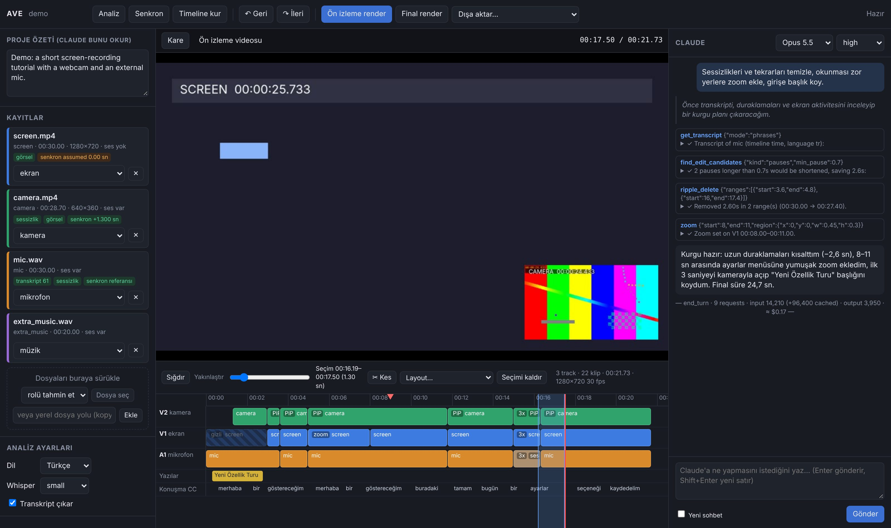

# AI Video Editor (AVE)

Claude destekli otomatik video editörü. Ham kayıtlarını (ekran kaydı, kamera, harici mikrofon, müzik)
verirsin. Program kayıtları analiz edip sese göre senkronlar ve bir timeline kurar. Claude bu timeline'ı
gerçek bir editör gibi araçlarla düzenler: keser, sıkılaştırır, layout değiştirir, zoom yapar,
hızlandırır, yazı, altyazı ve müzik ekler. Sonuç FFmpeg ile render edilir ya da Premiere, DaVinci Resolve
veya Final Cut'a aktarılır.



```
Kayıtlar ─► Analiz ─────────► Timeline ◄────► Claude (araç kullanımı) ─► Render (FFmpeg)
            transkript         track'ler,       "şu aralığı kes,           ön izleme / final
            sessizlikler       klipler,         kamerayı köşeye al,        veya XML/OTIO/EDL
            ekran aktivitesi   layout, yazı     burada zoom yap…"
            ses senkronu
```

## Nasıl çalışır?

Claude videoyu izleyemez, sesi de duyamaz. O yüzden program her kaydı Claude'un okuyabileceği bir
biçime çevirir:

| Ne                       | Nasıl                                                          | Claude'a nasıl ulaşır |
|--------------------------|----------------------------------------------------------------|-----------------------|
| Konuşma                  | faster-whisper ile kelime zamanlı transkript                   | timeline zamanına çevrilmiş metin |
| Duraklamalar             | enerji tabanlı konuşma/sessizlik tespiti                       | kesim önerileri, kesimleri sessizliğe oturtma |
| Ekranda olanlar          | düşük çözünürlüklü kare farkı (aktivite + sahne kesimi)        | "aktif / boş" aralıklar |
| Görüntü                  | kaynaktan veya kompozit çıktıdan kare                          | zaman damgalı kontak sayfaları (görsel) |
| Senkron                  | ses zarfı çapraz korelasyonu + GCC-PHAT, saat kayması tespiti  | otomatik, milisaniye düzeyinde |

Kayıtlar ortak bir saate oturtulup timeline'a alt alta dizilir. Claude bir aralığı kestiğinde bu kesim
bütün track'lerde aynı anda yapılır (ripple delete), böylece kamera, ekran ve mikrofon hep senkron
kalır. Her kesimden sonra transkript yeni timeline'a yeniden yansıtılır, Claude da her zaman güncel
zamanlarla çalışır.

## Kurulum

Gereksinimler: **Python 3.10+**, **FFmpeg** (PATH'te `ffmpeg` ve `ffprobe`) ve Claude'a erişim. Erişim için iki
yol var:

- **Claude aboneliği (Pro/Max, önerilen):** [Claude Code](https://code.claude.com) kurulu olsun ve bir kez `claude`
  çalıştırıp `/login` ile aboneliğinle giriş yap. Program, kurguyu senin Claude Code'una yaptırır (aşağıya bak).
- **API anahtarı:** `ANTHROPIC_API_KEY` ortam değişkeni (kullandığın kadar ödersin).

```bash
git clone https://github.com/speeedev/AiVideoEditor.git
cd AiVideoEditor
pip install -e ".[transcribe]"
```

- FFmpeg kurulumu: macOS'ta `brew install ffmpeg`, Windows'ta `winget install ffmpeg`, Ubuntu'da
  `sudo apt install ffmpeg`.
- `[transcribe]` ekstrası faster-whisper'ı kurar. İlk kullanımda Whisper modeli internetten indirilir.
  NVIDIA GPU varsa transkripsiyon çok daha hızlıdır. Türkçe için `--model medium` ya da `large-v3`
  belirgin şekilde daha isabetlidir (`small` hızlı ama daha çok hata yapar). Whisper'ın sessiz yerlerde
  uydurduğu "Altyazı M.K." gibi ifadeler otomatik olarak temizlenir.

## Claude aboneliğiyle kullanım (Claude Code)

Program Claude'u iki şekilde kullanabilir. Varsayılan `auto` modu, Claude Code kuruluysa aboneliği seçer.

| | Abonelik (Claude Code) | API anahtarı |
|---|---|---|
| Nasıl | Senin, giriş yapmış Claude Code'un kurguyu yapar; programın araçları ona MCP sunucusu olarak bağlanır | Program Claude API'sini doğrudan çağırır |
| Ücret | Abonelik limitlerinden düşer | Token başına ödeme |
| Seçim | `--backend claude-code` / arayüzde "Abonelik" | `--backend api` / arayüzde "API anahtarı" |

Abonelik modunda program Claude kimlik bilgilerine hiç dokunmaz: ne okur, ne saklar. Claude Code'u kendi
oturumunla çalıştırır ve API anahtarı değişkenlerini Claude Code'a geçirmez (yoksa Claude Code aboneliği değil
API anahtarını kullanırdı). Anthropic'in kuralları, kişinin kendi aboneliğiyle değiştirilmemiş Claude Code'u
kullanmasına izin veriyor. Ama üçüncü taraf uygulamaların başkalarına abonelik girişi sunmasına izin vermiyor.
Yani bu mod kişisel kullanım içindir; programı başkalarına dağıtırsan onlar API anahtarı kullanmalı.

Üç kullanım şekli:

1. **Web arayüzü:** `ave ui proje` → sağ paneldeki seçimden "Abonelik (Claude Code)".
2. **Komut satırı:** `ave edit proje "talimat"` (Claude Code kuruluysa otomatik olarak abonelikle çalışır).
3. **Doğrudan Claude Code içinde:** proje klasöründe `claude` çalıştır ve konuş. Yeni projeler (arayüzden ya da `ave init`), klasöre
   `.mcp.json` (araçlar) ve `CLAUDE.md` (kurgu rehberi) yazar; eski projeler için `ave claude-setup proje`.

```bash
cd benim-videom
claude
> Videoyu kurgula: sessizlikleri ve hataları temizle, okunmayan yerlere zoom yap
```

## Hızlı deneme (sentetik demo)

Elinde kayıt yoksa bile tüm akışı deneyebilirsin:

```bash
ave demo demo-proje          # sentetik ekran + kamera + mikrofon üretir, analiz eder, senkronlar
ave ui demo-proje            # tarayıcıda editörü açar
```

## Kendi kayıtlarınla kullanım

### Web arayüzü (önerilen)

```bash
ave ui
```

Diğer editörlerdeki gibi bir proje ekranı açılır: **Yeni proje** (ad, format: yatay 720p/1080p/2K/4K, dikey, kare ve isteğe bağlı
video açıklaması) ya da **Son projeler** listesinden birini aç. Projeler varsayılan olarak `Filmler/AVE Projeleri`
(Windows'ta `Videolar/AVE Projeleri`) klasörüne kaydedilir. Klasörü `AVE_WORKSPACE` ile değiştirebilirsin.
Her değişiklik anında kaydedilir; **Kaydet** (Cmd/Ctrl+S) bunu elle de yapar, **Farklı kaydet** projenin kopyasını
yeni adla açar (ör. aynı videonun dikey sürümü için). Üstteki **☰ Projeler** ile projeler arasında geçersin.

Proje açıldıktan sonra:

1. **Kayıtlar:** dosyaları sürükleyip bırak (ya da yerel yolunu yaz, büyük dosyalar kopyalanmaz). Rol (ekran,
   kamera, mikrofon, müzik, resim) dosyanın içeriğine göre otomatik seçilir; gerekirse listeden değiştir.
2. **Analiz:** dili ve Whisper modelini seç, sonra *Analiz*'e bas.
3. **Senkron:** kayıtları sese göre hizalar. Ardından *Timeline kur* senkronlu kayıtları timeline'a dizer
   (timeline boşsa Claude ilk talimatta bunu kendisi yapar).
4. **Claude paneli:** ne istediğini yaz, örneğin "Hataları ve tekrarları temizle, akıcı bir kurgu yap,
   kelime vurgulu altyazı ekle". Claude'un düşüncelerini, kullandığı araçları ve baktığı kareleri
   canlı izlersin. Timeline da gözünün önünde güncellenir.
5. Timeline'a tıklayınca o anın **kompozit karesi** görünür (layout, zoom, yazı ve altyazı dahil).
   Sürükleyerek bir **aralık seçebilirsin**: seçimi tek tıkla kesebilir (Delete), bir layout
   uygulayabilir ya da Claude'a "seçili aralığı…" diye talimat verebilirsin.
6. *Ön izleme render* ile videoyu izle, sonra "girişi biraz daha kısalt" gibi talimatlarla devam et.
   Her değişiklik geri alınabilir (Ctrl+Z).
7. *Final render* tam kalite MP4 üretir. *Dışa aktar* ile Premiere veya Resolve'a geçebilirsin.

### Komut satırı

```bash
ave init benim-videom --width 1920 --height 1080 --fps 30 --brief "YouTube eğitimi"
ave add benim-videom ekran.mp4 --role screen
ave add benim-videom kamera.mp4 --role camera
ave add benim-videom mikrofon.wav --role mic
ave analyze benim-videom --language tr --model medium
ave sync benim-videom
ave assemble benim-videom
ave edit benim-videom "Sessizlikleri ve hataları temizle, okunmayan yerlere zoom yap"
ave render benim-videom --preview          # hızlı ön izleme
ave edit benim-videom "Girişi kısalt ve başlık ekle"   # aynı sohbete devam eder
ave render benim-videom -o final.mp4
```

Diğer komutlar:

| Komut | Ne yapar |
|---|---|
| `ave chat PROJE` | terminalde etkileşimli sohbetle düzenleme (`/undo`, `/render`, `/show`) |
| `ave show PROJE` | timeline'ı metin olarak gösterir |
| `ave transcript show PROJE [--words]` | timeline zamanlı transkript |
| `ave transcript import PROJE --asset mic --file x.srt` | hazır transkript (JSON/SRT/VTT) içe aktarır |
| `ave sync PROJE --manual kamera 1.25` | senkronu elle ayarlar |
| `ave add PROJE kayit.mkv --role mic --audio-stream 1` | çok track'li kayıttan (ör. OBS) belirli ses track'ini kullanır |
| `ave still PROJE 12.5 -o kare.jpg` | timeline'ın tek karesini render eder |
| `ave undo PROJE [--steps N]` | son değişiklikleri geri alır |
| `ave export PROJE --format xml\|otio\|edl\|json\|srt` | diğer editörlere aktarır / altyazı dosyası üretir |
| `ave status PROJE` | projenin durumu ve sıradaki adım |
| `ave brief PROJE "metin"` | proje özetini ayarlar |
| `ave claude-setup PROJE` | Claude Code için `.mcp.json` ve `CLAUDE.md` yazar |
| `ave mcp PROJE` | düzenleme araçlarını MCP sunucusu olarak çalıştırır (Claude Code başlatır) |

Claude bağlantısı: `--backend auto|claude-code|api` (`AVE_BACKEND`). Model: `--model` (`AVE_MODEL`; API modunda
varsayılan `claude-opus-5-5`, abonelik modunda Claude Code'un varsayılanı). API modunda düşünme derinliği:
`--effort low|medium|high|xhigh|max` (varsayılan `high`, `AVE_EFFORT`).

## Claude'un araçları

| Araç | Ne işe yarar |
|---|---|
| `get_project_overview`, `get_timeline` | kayıtlar, senkron bilgisi, track ve klipler |
| `get_transcript` | timeline veya kaynak zamanlı transkript (cümle ya da kelime düzeyinde) |
| `find_edit_candidates` | uzun duraklama, dolgu kelime (eee/ıı, um/uh) ve tekrar çekim önerileri |
| `get_visual_activity` | ekranın değiştiği ve boş kaldığı aralıklar |
| `view_source`, `view_timeline` | ham kayıttan ya da kompozit çıktıdan kareler (görsel) |
| `ripple_delete` | aralıkları tüm track'lerden keser, boşluğu kapatır, kesimleri sessizliğe oturtur |
| `apply_layout` | `screen_only`, `camera_only`, `pip`, `side_by_side`, `stack` (dikey video) |
| `zoom` | ekran kaydında bir bölgeye yumuşak (animasyonlu) yakınlaşma ve geri açılma |
| `speed_up` | boş beklemeleri hızlandırma |
| `add_music` | konuşma altında otomatik kısılan (ducking) müzik |
| `add_overlay` | logo, slayt, ekran görüntüsü veya b-roll videosu bindirme (konum, boyut, saydamlık, fade) |
| `set_audio_mastering` | final miksin loudness hedefi (varsayılan -14 LUFS, YouTube standardı) |
| `add_text`, `set_captions` | başlık ve yazılar, kelime vurgulu altyazı |
| `place_clip`, `move_clip`, `trim_clip`, `split`, `lift`, `delete_clips`, `set_clip_properties` | klip düzeyinde ince ayar |
| `set_track` | sessize alma, gizleme, kilitleme, ducking, **gürültü azaltma** ve **ses iyileştirme** |
| `add_marker` | insan editöre not |
| `set_canvas` | çıktı boyutu: yatay 720p/1080p/1440p (2K)/4K, dikey 1080×1920 (Shorts/Reels), kare |
| `save_text` | YouTube başlığı, açıklama, bölüm (chapter) listesi gibi metinleri `exports/` altına kaydeder |
| `undo`, `render_preview`, `assemble_timeline` | geri alma, ön izleme, baştan kurma |

Başarısız bir araç çağrısı hiçbir şeyi değiştirmez. Her değişiklik `history/` klasörüne kaydedilir, bu
yüzden farklı çalıştırmalar arasında da geri alınabilir.

## Dışa aktarma

- **FCP7 XML (`xml`):** Premiere Pro, DaVinci Resolve ve Final Cut içe aktarır.
- **OpenTimelineIO (`otio`):** Resolve 18+ ve pek çok iş akışı.
- **EDL:** tek video ve tek ses track'i (CMX3600).
- **SRT:** kurgulanmış videonun altyazı dosyası (YouTube'a ayrı altyazı olarak yüklemek için).

Kesimler, track yerleşimi, hız ve ses seviyeleri aktarılır. Layout kutuları, zoom, yazılar ve altyazı bu
programın kendi render motoruna özgüdür, aktarılmaz. Bunlar için videoyu render et ya da NLE'de yeniden
oluştur.

## Proje klasörü

```
benim-videom/
  project.json        kayıtlar, roller, senkron ofsetleri, proje özeti
  timeline.json       güncel kurgu
  history/            her değişiklikten önceki timeline (geri alma)
  analysis/<kayıt>/   transcript.json, speech.json, visual.json
  cache/proxies/      düşük çözünürlüklü düzenleme kopyaları
  agent/              Claude sohbeti (conversation.json) ve araç günlüğü (log.jsonl)
  renders/            ön izleme ve final videolar
  exports/            XML / OTIO / EDL / SRT ve Claude'un kaydettiği metinler (açıklama, bölümler)
  media/              arayüzden yüklenen dosyalar
```

## Mimari

```
src/aivideoeditor/
  media/        ffmpeg/ffprobe sarmalayıcıları
  analysis/     ses çözme, konuşma/sessizlik, görsel aktivite, kareler, transkript, senkron
  timeline/     veri modeli, düzenleme işlemleri, layout/zoom, transkript eşleme, özetler
  render/       parçalı FFmpeg render motoru, ASS altyazı üretimi
  agent/        Claude araç tanımları, sistem promptu, streaming araç döngüsü
  pipeline.py   analiz ve senkron adımları
  session.py    undo, render ve kontak sayfası yardımcıları
  export.py     FCP7 XML, OTIO, EDL ve SRT dışa aktarma
  web.py        yerel web sunucusu (stdlib) ve webui/ tek sayfa uygulaması
  cli.py        `ave` komut satırı
```

- **Proxy:** analiz sırasında yüksek çözünürlüklü videoların 360p, sık keyframe'li kopyaları üretilir. Ön
  izleme render'ları ve Claude'un baktığı kareler bunlardan alınır (çok kesimli 10 dakikalık bir kurguda ön
  izleme yaklaşık 2 kat hızlı, 12 karelik kontak sayfası 1 saniyenin altında). Final render her zaman
  orijinal dosyaları kullanır.
- **Render:** timeline zaman parçalarına bölünür. Her parça tek bir ffmpeg çalıştırmasıdır: klipler
  doğru noktadan açılır, `overlay` ile birleştirilir ve ses PCM olarak örnek hassasiyetinde karıştırılır.
  Parçalar kayıpsız birleştirilir. Böylece aynı anda açık decoder sayısı sınırlı kalır ve çok kesimli uzun
  kurgular da güvenilir şekilde render olur (test: 10 dakika, 537 klip).
- **Ajan:** `claude-opus-5-5` ile streaming araç döngüsü kullanılır. Adaptif düşünme, prompt caching ve
  sunucu taraflı fallback açıktır, araç girdileri pydantic ile doğrulanır. Sohbet yalnızca sona ekleme
  yapılarak diske yazılır. Görseller araç sonuçlarının içinde gönderilir.

## Sessiz videolar ve resimler

- **Sadece ekran kaydı, hiç ses yok:** desteklenir. Analiz, ekranda ne zaman ve **nerede** değişiklik olduğunu
  (yazı yazma, imleç, menüler) çıkarır. Claude `scan_video` ile değişim anlarındaki kareleri tarar, boş beklemeleri
  keser ya da hızlandırır, önemli yerlere zoom yapar. Başlık, yazı ve müzik isteğe göre eklenir. Çıktı yine MP4'tür.
- **Resimler:** PNG/JPG/WebP kayıtlara eklenebilir. Claude bunları logo, slayt, ekran görüntüsü ya da tam ekran
  görsel olarak (`add_overlay`) kullanır.

## Sınırlamalar ve yol haritası

- Sesi olmayan birden fazla kayıt (ör. sessiz ekran kaydı + sessiz kamera) sese göre senkronlanamaz. Bunlar aynı
  anda başlamış kabul edilir; `ave sync --manual` ile düzeltilebilir.
- Whisper dolgu kelimeleri bazen atlar. Duraklama analizi bunu büyük ölçüde telafi eder.
- Planlananlar: klipler arası geçiş efektleri (crossfade), müzik ritmine kesim, timeline'da
  sürükle-bırak düzenleme.

## Geliştirme

```bash
pip install -e ".[dev]"
pytest
```

Testler sentetik medya üretir: senkron doğruluğu ve saat kayması, ses-görüntü senkronu, analiz, timeline
işlemleri, örnek hassasiyetinde parçalı render, zoom/loudness/bindirme, sahte istemciyle ve gerçek SDK ile
(yerel API taklidine karşı) ajan döngüsü, CLI ve web sunucusu. GitHub Actions her push'ta testleri çalıştırır.
